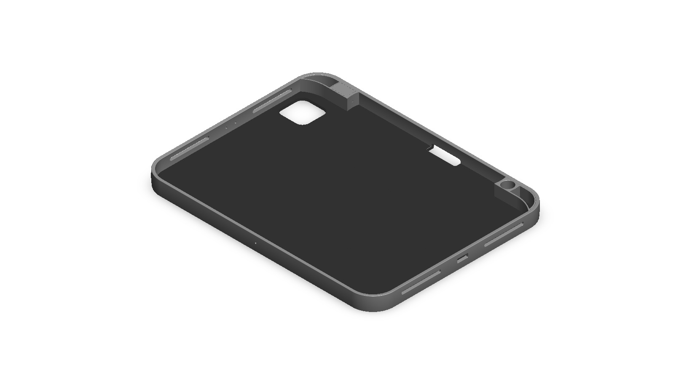
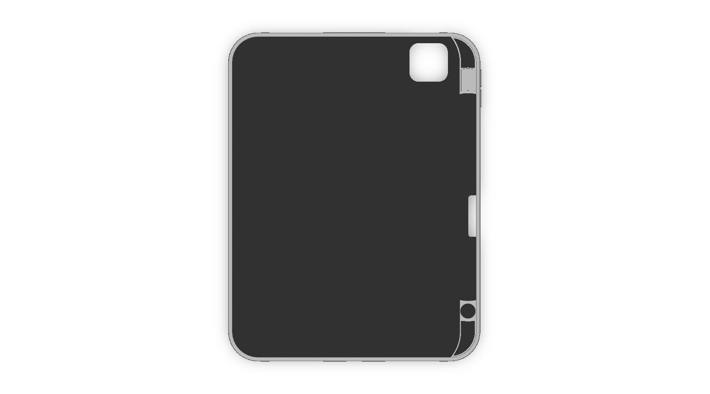
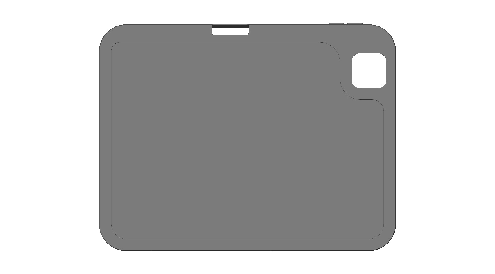
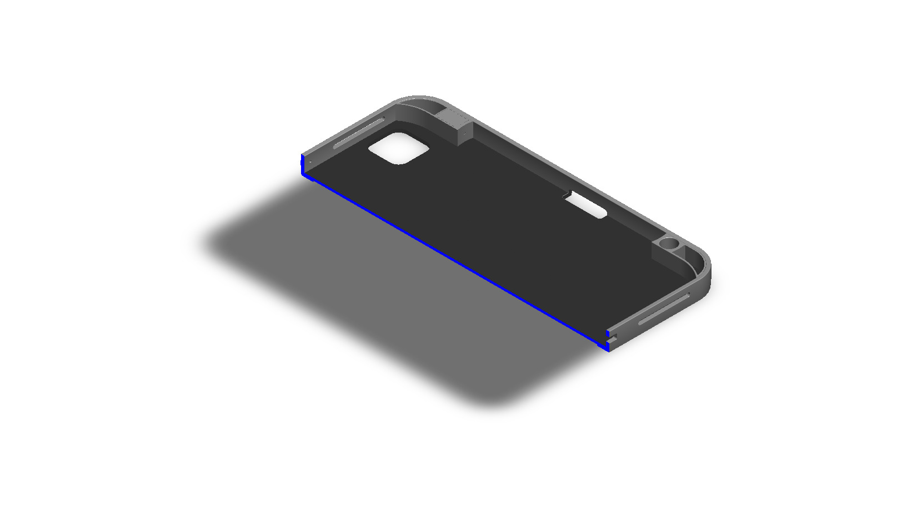

# Concept Design Prototype of an iPad Cover

## Summary

---

## Design Motivation

| Name | Image |
| :--: | :---: |

---

## Computational Design

|   View    |                          Image                          |
| :-------: | :-----------------------------------------------------: |
| Isometric |  |
|   Left    |            |
|   Right   |          |
|   Back    |            |
|   Front   |          |
|    Top    |              |
|  Bottom   |        |
|  Section  |      |

---

## Technologies Used

| Purpose |               Name                |
| :-----: | :-------------------------------: |
| Design  | SolidWorks 2024 (Student Version) |

---

## Applications [^1][^2]

- Screen and Back Protection
- Viewing Stand for Video Calls and Media
- Typing Stand with an Angled Incline
- Keyboard Case Integration
- Automatic Wake and Sleep with a Magnetic Cover
- Port, Speaker, and Camera Access Through Cutouts

---

## Design Limitations

The design of the iPad cover was developed as a prototype product. That’s why the real-life design considerations, including usability, material selection, drop protection, hinge or stand mechanism, compatibility with other iPad models, proper design specification, monetization, and feasibility, have not been included.

---

## Future Improvements

The cover was designed as a single-model prototype. A fold line or hinge, a magnet pocket for wake and sleep, and an adjustable stand mechanism should be added so that it can serve as both a viewing and a typing stand. Drop and bending simulations, along with a material selection between hard polycarbonate shells and soft TPU or faux leather, are needed to evaluate protection. Parametric cutouts would also let the design be adapted to other iPad generations and sizes.

---

## References

[^1]: [The week in iPad cases, stands, keyboards, and bags](https://www.macworld.com/article/224450/the-week-in-ipad-cases-stands-keyboards-and-bags.html)

[^2]: [TYPEFOLIO Keyboard Case for iPad / iPad Pro / iPad Air](https://www.itslaut.com/products/typefolio-keyboard-case-for-ipad-pro-11-inch-2022-2018)
