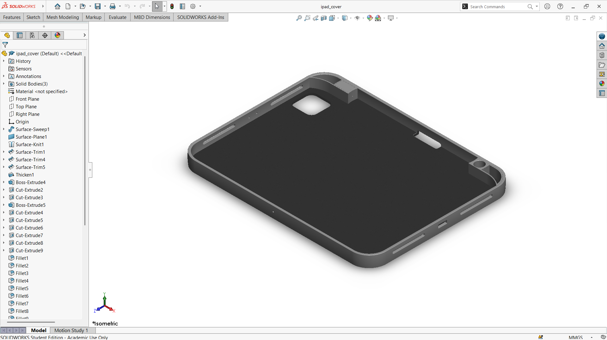
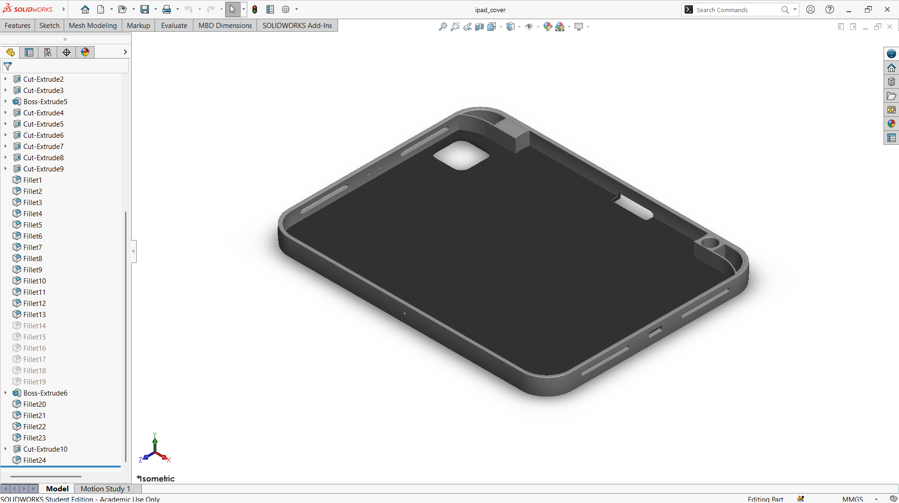

# A Commercial-Inspired Protective Cover for an iPad

## Summary

Tablets and phones are among the devices people handle the most, and almost all of them are used with a protective cover. While looking at the covers sold for the iPad and for mobile phones, I became curious about how such a simple-looking product is shaped around the device it protects. This project began from that curiosity. I tried to mimic the design of commercial covers by modeling an iPad cover around my own tablet, the iPad Pro M2, and by studying the same idea on my mobile phone, the Samsung Galaxy J6.

The cover is a thin shell with a raised rim that wraps the edges of the tablet and holds it in place. Openings are cut into the shell so that the camera, the speakers, the volume buttons, and the charging port stay accessible while the cover is on. The main challenge was to place each opening in the right position and keep the rim uniform around the rounded corners, because a cover that is slightly off will either block a feature or fit loosely. Instead of drawing a flat box, I built the cover as a computational model in SolidWorks, so that every view, including the section view, shows how the wall, the rim, and the openings come together. This prototype is a base concept that can later be refined into a complete product.

---

## Computational Design

|   View    |                          Image                          |
| :-------: | :-----------------------------------------------------: |
| Isometric |  |
|   Left    |            |
|   Right   |          |
|   Back    |            |
|   Front   |          |
|    Top    |              |
|  Bottom   |        |
|  Section  |      |

---

## Software Used

| Purpose |               Name                |
| :-----: | :-------------------------------: |
| Design  | SolidWorks 2024 (Student Version) |

---

## Feature Tree

| No  |     Name      |
| :-: | :-----------: |
| 01  | Surface Sweep |
| 02  | Surface Plane |
| 03  | Surface Knit  |
| 04  | Surface Trim  |
| 05  |    Thicken    |
| 06  | Boss Extrude  |
| 07  |  Cut Extrude  |
| 08  |    Fillet     |

---

## Feature Tree Image

| No  |                                  Name                                  |
| :-: | :--------------------------------------------------------------------: |
| 01  |  |
| 02  |  |

---

## Applications [^1][^2]

- Screen and Back Protection
- Viewing Stand for Video Calls and Media
- Typing Stand with an Angled Incline
- Keyboard Case Integration
- Automatic Wake and Sleep with a Magnetic Cover
- Port, Speaker, and Camera Access Through Cutouts

---

## Design Limitations

The design of the iPad cover was developed as a prototype product. That’s why the real-life design considerations, including usability, material selection, drop protection, hinge or stand mechanism, compatibility with other iPad models, proper design specification, monetization, and feasibility, have not been included.

---

## Future Improvements

The cover was designed as a single-model prototype. A fold line or hinge, a magnet pocket for wake and sleep, and an adjustable stand mechanism should be added so that it can serve as both a viewing and a typing stand. Drop and bending simulations, along with a material selection between hard polycarbonate shells and soft TPU or faux leather, are needed to evaluate protection. Parametric cutouts would also let the design be adapted to other iPad generations and sizes.

---

## Acknowledgements

I would like to thank the [CAD CAM Tutorials](https://www.youtube.com/c/CADCAMTutorials) YouTube channel for its tutorials and learning resources, and [Mr. Md. Abdus Salam](https://mpe.iutoic-dhaka.edu/profile/salam/education), Drafting Instructor, Department of Mechanical and Production Engineering, Islamic University of Technology, for his guidance and support, and for his assistance in our ME 4210 3D Solid Modeling and Assembling lab course. I took assistance from [Claude](https://claude.ai), an AI assistant by [Anthropic](https://www.anthropic.com), in preparing this documentation. I provided the template, and Claude followed it and my instructions.

---

## References

[^1]: [The week in iPad cases, stands, keyboards, and bags](https://www.macworld.com/article/224450/the-week-in-ipad-cases-stands-keyboards-and-bags.html)

[^2]: [TYPEFOLIO Keyboard Case for iPad / iPad Pro / iPad Air](https://www.itslaut.com/products/typefolio-keyboard-case-for-ipad-pro-11-inch-2022-2018)
